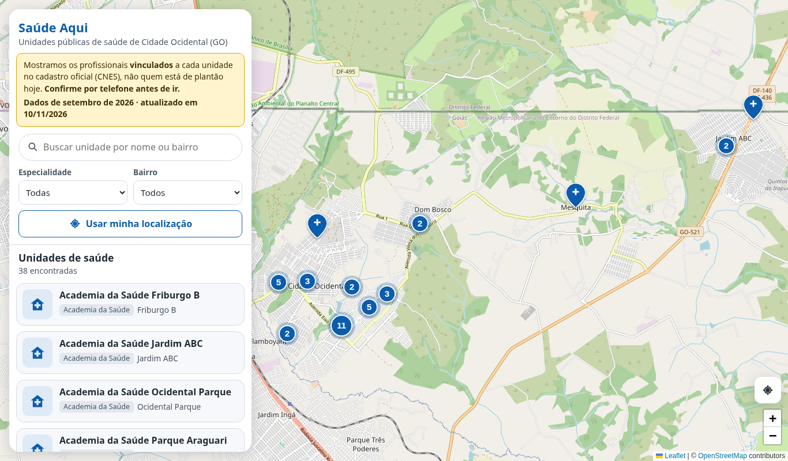
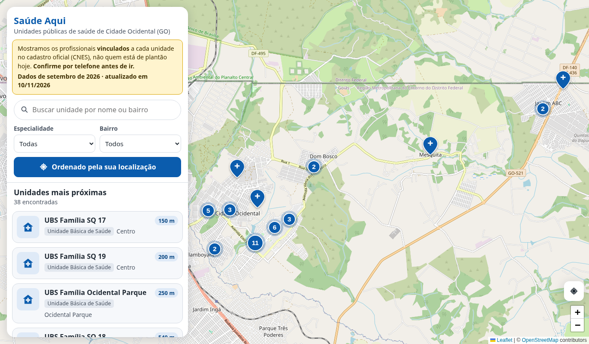
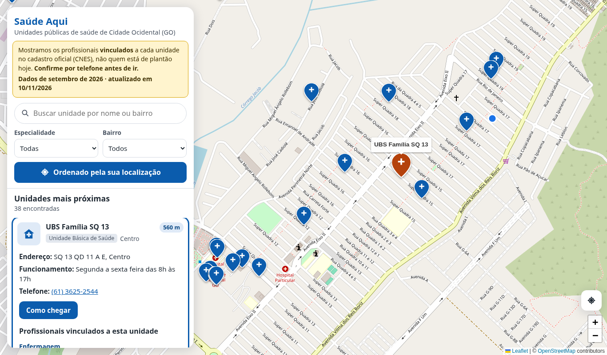
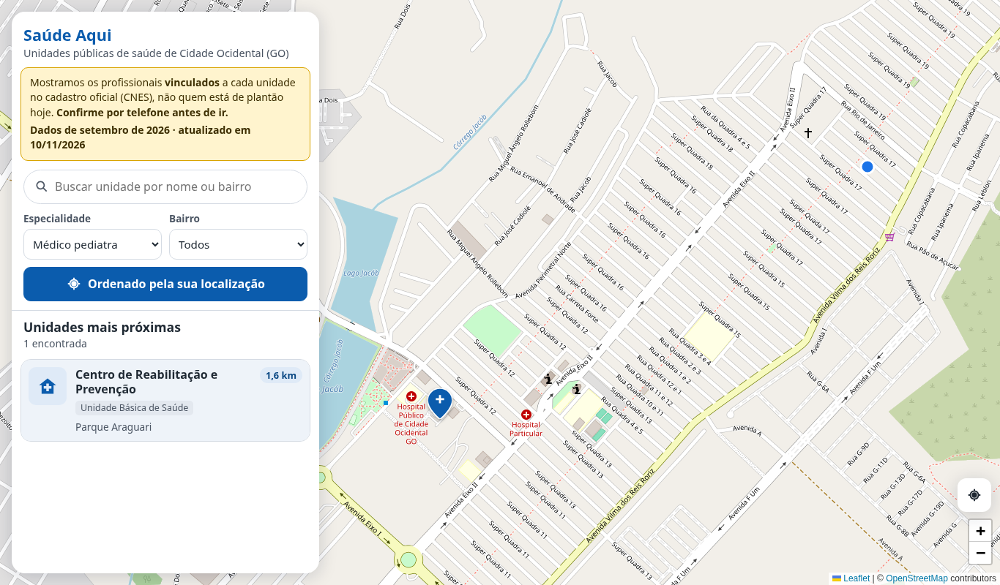
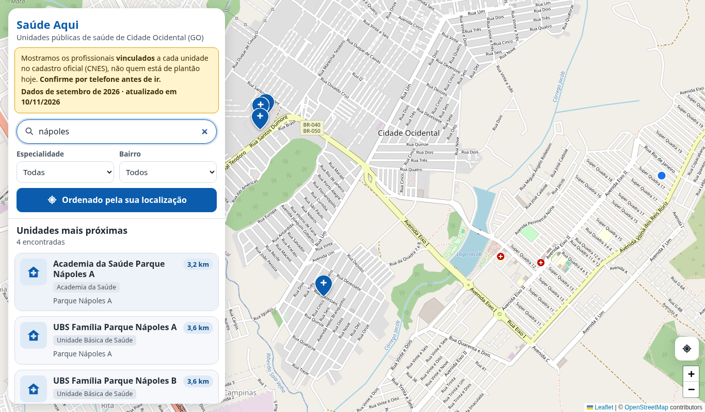
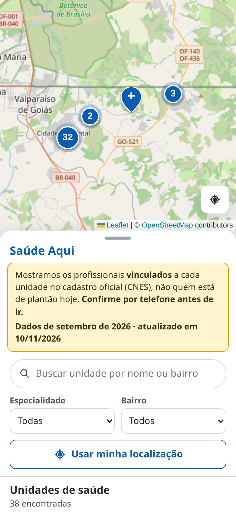
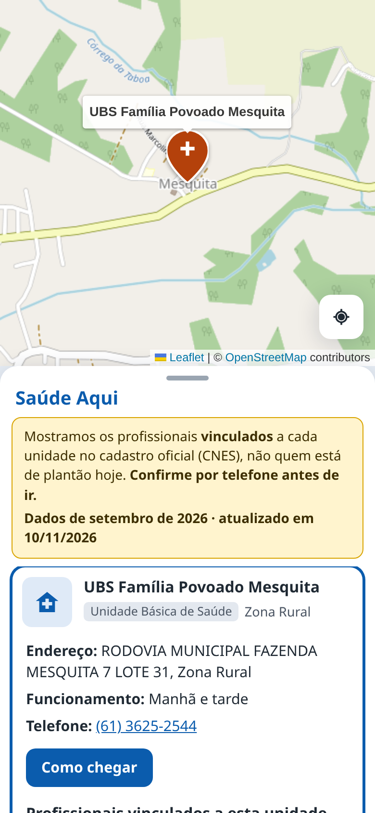
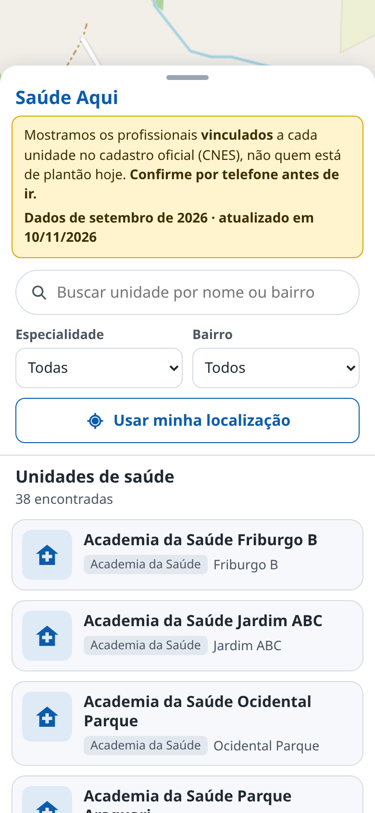
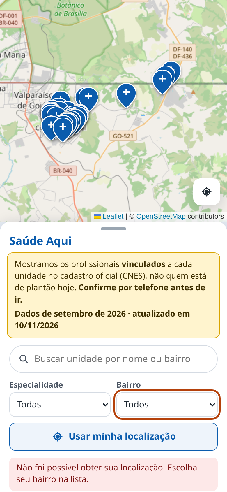

# Saúde Aqui

Site que ajuda moradores de Cidade Ocidental (GO) a encontrar **unidades públicas de saúde**
perto de onde estão (ou no bairro escolhido) e a ver **quais profissionais estão vinculados**
a cada unidade.

Projeto de alunos de graduação da UFG. O código é propositalmente simples e comentado em português.

> ⚠️ Os dados vêm do CNES (Cadastro Nacional de Estabelecimentos de Saúde). Eles mostram quem
> está **vinculado** a cada unidade, e não quem está de plantão hoje. O site sempre orienta a
> confirmar por telefone antes de ir.

## Funcionalidades

> As capturas abaixo usam os dados reais do CNES (competência setembro/2026).

### Mapa e lista de unidades

Mapa em tela cheia, com um painel de busca e a lista de unidades. O aviso fixo explica que os dados
mostram profissionais **vinculados** (e não plantões) e informa a data da última atualização.



### Unidades mais próximas

"Usar minha localização" reordena a lista por distância, mostra quantos metros ou km faltam até
cada unidade e marca a sua posição no mapa (ponto azul).



### Detalhes da unidade e profissionais vinculados

Ao clicar num cartão (ou num marcador), o mapa centraliza a unidade. O cartão mostra endereço,
horário de funcionamento, telefone (o número abre a ligação), o botão **Como chegar** (Google Maps)
e os **profissionais vinculados**, agrupados por categoria, com ocupação e carga horária semanal.



### Filtros e busca

Filtro por especialidade (agrupada por categoria: Medicina, Enfermagem, Odontologia…), por bairro
e busca por nome ou bairro, que ignora acentos ("napoles" encontra "Nápoles").

| Filtro por especialidade (médico pediatra) | Busca por texto ("nápoles") |
|---|---|
|  |  |

### No celular

O mapa fica na parte de cima e a lista numa gaveta, que se expande pela alça. Tocar num marcador
abre a unidade correspondente na lista. Se a pessoa negar o acesso à localização, o site sugere
escolher o bairro e já posiciona o cursor nesse filtro.

<table>
  <tr>
    <th>Visão geral</th>
    <th>Toque no marcador</th>
    <th>Lista expandida</th>
    <th>Localização negada</th>
  </tr>
  <tr>
    <td></td>
    <td></td>
    <td></td>
    <td></td>
  </tr>
</table>

### Acessibilidade

Fonte mínima de 16 px, contraste AA, foco sempre visível e navegação pelo teclado na lista
(Tab chega na lista, as setas ↑/↓ passam de uma unidade para outra e Enter abre ou fecha).

## De onde vêm os dados

| Dado | Fonte | Atualização |
|---|---|---|
| Unidades (nome, endereço, bairro, telefone, coordenadas, turno) | API de dados abertos do Ministério da Saúde (`apidadosabertos.saude.gov.br/cnes/estabelecimentos`) | contínua |
| Profissionais × unidade (nome, ocupação CBO, carga horária semanal) | FTP do DATASUS, arquivo mensal `PFGOaamm.dbc` | mensal (~2 meses de atraso) |
| Horário de funcionamento escrito pela Prefeitura; aviso de escala nova | [Portal de escalas da Prefeitura](https://acessoainformacao.cidadeocidental.go.gov.br/cidadao/outras_informacoes/escalasmedicas) (só publicações de 2026 em diante) | quando a Prefeitura publica |

Os detalhes da investigação estão em [`coletor/amostras/ACHADOS.md`](coletor/amostras/ACHADOS.md).

**Privacidade:** o coletor descarta CNS (Cartão SUS), CPF e registro em conselho. Guardamos só
nome, ocupação e carga horária.

## Arquivos que os alunos podem editar

* **`db/unidades.csv`**: ajustes manuais por unidade (chave: código CNES). Uma coluna vazia
  significa "usar o valor do CNES".
  * `nome`, `bairro`, `telefone`, `lat`, `lng`: corrigem o que veio do CNES.
  * `horario`: texto livre (ex.: `Seg a sex, 7h às 17h`). Quando preenchido, tem prioridade
    sobre o horário do portal da Prefeitura e sobre o turno do CNES.
  * `portal_id`: código da unidade no portal de escalas da Prefeitura. Uma unidade do portal
    pode cobrir duas do CNES (ex.: "UBSF SQ 11/12" → SQ 11 e SQ 12).
  * `ativo`: `nao` esconde a unidade do site (ex.: setores administrativos, SAMU).
* **`db/ocupacoes.csv`**: quais ocupações (CBO) aparecem no site. Mude `incluir` para
  `sim`/`nao`; não apague linhas. Depois de editar, rode o coletor com `--forcar`.

## Estrutura

```
saude-aqui/
├── docker-compose.yml          # desenvolvimento local
├── docker-compose.prod.yml     # produção (Easypanel), com imagens do GHCR
├── .github/workflows/build.yml # testes + build e push das imagens para o GHCR
├── .env.example
├── db/          # Postgres: init.sql, unidades.csv, ocupacoes.csv
├── api/         # FastAPI
├── coletor/     # baixa CNES/DATASUS e importa (agendado com supercronic)
└── web/         # React + Vite + TypeScript + Leaflet/OpenStreetMap
```

| Serviço | Imagem base | Limite de memória |
|---|---|---|
| db | postgres:16-alpine | 384 MB |
| api | python:3.12-slim + uvicorn (1 worker) | 192 MB |
| coletor | python:3.12-slim + supercronic | 256 MB |
| web | nginx:alpine | 64 MB |

## Rodando localmente

```bash
cp .env.example .env            # ajuste a senha
docker compose up -d db         # sobe o banco (o schema é criado na 1ª vez)
docker compose exec db psql -U saude_aqui -d saude_aqui   # inspecionar
```

Para recriar o banco do zero (apaga os dados): `docker compose down -v`.

Antes de existir coleta real, dá para carregar **dados fictícios** (para desenvolver o front-end):

```bash
docker compose exec -T db psql -U saude_aqui -d saude_aqui < db/dados_ficticios.sql
```

## API

```bash
docker compose up -d --build api
# Documentação interativa: http://localhost:8000/api/docs
# (se a porta 8000 estiver ocupada, defina API_PORTA=8001 no .env)
```

| Método | Rota | Descrição |
|---|---|---|
| GET | `/api/health` | Verificação de saúde |
| GET | `/api/status` | Última atualização, última verificação e competência (mês) do CNES |
| GET | `/api/bairros` | Bairros que têm unidades |
| GET | `/api/especialidades` | Ocupações presentes (CBO, nome, categoria, total) |
| GET | `/api/unidades?bairro=` | Unidades com coordenadas (para o mapa) |
| GET | `/api/unidades/proximas?lat=&lng=&raio_km=&bairro=&categoria=&cbo=` | Unidades com os **profissionais vinculados**; com lat/lng, ordena por distância e retorna `distancia_km` |

### Testes da API

Os testes usam um banco separado (`saude_aqui_teste`), recriado a cada execução com
`db/init.sql` + `db/dados_ficticios.sql`. É preciso ter o banco no ar.

```bash
docker compose up -d db
cd api
python -m venv .venv && . .venv/bin/activate
pip install -r requirements-dev.txt
pytest
```

## Front-end

React + Vite + TypeScript, com mapa **Leaflet + OpenStreetMap** (gratuito, sem chave de API).

```bash
docker compose up -d --build web    # http://localhost:8080 (o nginx repassa /api para a API)
```

* **Layout:** mapa em tela cheia com um painel lateral no desktop. No celular, o mapa fica
  em cima e a lista aparece numa gaveta inferior, que pode ser expandida pela alça.
* **Lista e mapa sincronizados:** clicar num cartão centraliza o marcador; clicar num
  marcador abre e mostra o cartão.
* **Filtros:** busca por nome/bairro (feita no próprio navegador), especialidade, bairro e
  "Usar minha localização" (reordena por distância). Se a permissão for negada, o site
  sugere escolher o bairro.
* **"Como chegar"** é um link gratuito do Google Maps (`google.com/maps/dir/?api=1&destination=LAT,LNG`).
* **Aviso fixo:** os dados mostram profissionais *vinculados* (CNES), e não plantões. Sempre
  peça para confirmar por telefone.
* **Acessibilidade:** fonte de 16 px, contraste AA, foco visível, Tab/Enter e setas ↑/↓ na lista.

**Regras do OpenStreetMap:** a atribuição fica visível no canto do mapa, e o servidor de tiles
`tile.openstreetmap.org` aceita só uso leve. Se o tráfego crescer, troque `VITE_TILES_URL`
(e `VITE_TILES_ATRIBUICAO`) por um provedor com plano gratuito, sem mudar o código.

### Desenvolvimento e testes do front-end

Não é preciso ter Node instalado: dá para usar o Node pelo Docker.

```bash
cd web
docker run --rm -it -v "$PWD":/app -w /app -u "$(id -u):$(id -g)" node:22-alpine npm install
docker run --rm -it -v "$PWD":/app -w /app -u "$(id -u):$(id -g)" node:22-alpine npm test
```

Com Node 22 instalado: `npm install`, `npm test` e `API_URL=http://localhost:8000 npm run dev`
(abre em http://localhost:5173).

## Coletor

Importa os dados do CNES/DATASUS para o banco. Cada execução faz o seguinte:

1. sincroniza `db/ocupacoes.csv` → tabela `ocupacao`;
2. busca as unidades na API de dados abertos, mantém só as públicas (CNPJ da mantenedora =
   Município) e aplica os ajustes de `db/unidades.csv`;
3. descobre a competência mais recente no FTP (`PFGOaamm.dbc`), baixa o arquivo para
   `/dados/brutos/` e calcula o SHA-256. **Se o arquivo já foi importado, para aqui** e registra
   `sem_novidade`;
4. descomprime, lê só os registros de Cidade Ocidental, **descarta CNS, CPF e registro em
   conselho** e grava os vínculos das ocupações de atendimento.

Antes do passo 3, o coletor também consulta o **portal de escalas da Prefeitura**, considerando
só as publicações de 2026 em diante (variável `PORTAL_DESDE`):

* grava o **horário de funcionamento** escrito pela Prefeitura (ex.: "Segunda a sexta das 8h às 22h
  e sábados das 8h às 12h"). A ordem de prioridade é: horário manual do `unidades.csv`, depois o
  do portal, depois o turno do CNES;
* baixa e verifica cada arquivo anexo **uma única vez** (tabela `arquivo_portal`). Até hoje todos
  os arquivos de 2026 são a "Listagem de Profissionais" do CNES, cujo conteúdo o site já tem por
  outra fonte (mais completa e mais recente). **Se a Prefeitura publicar uma escala de verdade**
  (outro tipo de PDF, uma planilha etc.), o coletor registra um aviso no log e na coluna `avisos`
  da tabela `coleta`. Aí basta escrever o leitor para o formato novo;
* se o portal estiver fora do ar, a coleta do CNES continua normalmente e o problema vira um aviso.

Para ver os avisos:
`docker compose exec db psql -U saude_aqui -d saude_aqui -c "SELECT baixado_em, avisos FROM coleta WHERE avisos IS NOT NULL ORDER BY id DESC"`

**Banco criado antes desta versão?** Aplique a migração uma vez:
`docker compose exec -T db psql -U saude_aqui -d saude_aqui < db/migracoes/001_portal_prefeitura.sql`

Toda execução gera uma linha na tabela `coleta`, com status `sucesso`, `sem_novidade` ou
`erro` e a mensagem do erro, quando houver.

```bash
docker compose up -d coletor                              # agendado: todo dia às 02:00 (Brasília)
docker compose run --rm coletor python coletar.py          # execução manual
docker compose run --rm coletor python coletar.py --forcar # reimporta (ex.: depois de editar os CSVs)
docker compose run --rm coletor python coletar.py --competencia 2608   # um mês específico (AAMM)
docker compose logs -f coletor                             # acompanhar os logs
```

O agendamento usa o [supercronic](https://github.com/aptible/supercronic) (arquivo
`coletor/crontab`). Uma importação completa leva cerca de 10 segundos e usa menos de 50 MB
de memória.

**Depois de editar `db/unidades.csv` ou `db/ocupacoes.csv`**, gere a imagem de novo
(`docker compose build coletor`) e rode com `--forcar`. Em produção, o GitHub Actions gera a
imagem nova a cada push.

### Testes do coletor

Usam as amostras reais (já sem dados pessoais) de `coletor/amostras/` e um banco de teste
separado. A rede não é acessada.

```bash
docker compose up -d db
cd coletor
pip install -r requirements-dev.txt
pytest
```

## Implantação (AWS EC2 + Easypanel)

```
 push na main ──► GitHub Actions ──► testes ──► 4 imagens no GHCR ──► Easypanel (VM) puxa e roda
```

**Nenhuma imagem é compilada na VM.** O GitHub Actions (`.github/workflows/build.yml`)
roda os testes e publica estas imagens:

| Imagem | Limite de memória |
|---|---|
| `ghcr.io/leandropedrosa/saude-aqui-db:latest` | 384 MB |
| `ghcr.io/leandropedrosa/saude-aqui-api:latest` | 192 MB |
| `ghcr.io/leandropedrosa/saude-aqui-coletor:latest` | 256 MB |
| `ghcr.io/leandropedrosa/saude-aqui-web:latest` | 64 MB |

Cada imagem também ganha uma tag com o hash do commit, o que permite voltar a uma versão anterior.

### 1. Criar a VM

1. No console da AWS, crie uma instância **EC2 t3.small** (2 GB, x86_64) com **Ubuntu 24.04 LTS**
   e disco de **20 GB** (gp3).
2. **Security group:**
   * 22 (SSH): só o seu IP;
   * 80 e 443 (HTTP/HTTPS): qualquer origem;
   * 3000 (painel do Easypanel): só o seu IP. Depois de configurar um domínio para o painel,
     você pode fechar essa porta.
3. Associe um **Elastic IP**, para o endereço não mudar quando a VM reiniciar.
4. No seu provedor de DNS, crie um registro **A** apontando o domínio (ex.: `saudeaqui.exemplo.org`)
   para o Elastic IP.

### 2. Criar 2 GB de swap (rede de segurança para a memória)

```bash
ssh ubuntu@SEU_IP
sudo fallocate -l 2G /swapfile
sudo chmod 600 /swapfile
sudo mkswap /swapfile
sudo swapon /swapfile
echo '/swapfile none swap sw 0 0' | sudo tee -a /etc/fstab   # mantém após reiniciar
echo 'vm.swappiness=10' | sudo tee /etc/sysctl.d/99-swap.conf # usa swap só quando precisa
sudo sysctl --system
free -h                                                        # deve mostrar "Swap: 2.0Gi"
```

### 3. Instalar o Easypanel

```bash
curl -sSL https://get.easypanel.io | sudo sh
```

Abra `http://SEU_IP:3000` e crie o usuário administrador.

### 4. Permitir que a VM baixe as imagens do GHCR

As imagens nascem **privadas** no GHCR. Escolha uma das opções:

* **Imagens públicas (mais simples):** no GitHub, abra *seu perfil → Packages*. Em cada
  pacote `saude-aqui-*`, vá em *Package settings → Change visibility → Public*. As imagens
  não têm segredos: a configuração e as senhas ficam nas variáveis do Easypanel.
* **Imagens privadas:** crie um *Personal access token (classic)* só com a permissão
  `read:packages` e cadastre no Easypanel em *Settings → Docker registries*
  (registro `ghcr.io`, usuário do GitHub e o token).

### 5. Criar o projeto no Easypanel

1. Crie o projeto **saude-aqui** e adicione um serviço do tipo **Compose**.
2. Cole o conteúdo de `docker-compose.prod.yml`. Se o repositório for de outro dono, troque
   `leandropedrosa` nas linhas `image:`.
3. Em **Environment**, defina as variáveis (gere uma senha forte, por exemplo com `openssl rand -hex 24`):

   ```env
   POSTGRES_DB=saude_aqui
   POSTGRES_USER=saude_aqui
   POSTGRES_PASSWORD=SENHA_FORTE
   DATABASE_URL=postgresql://saude_aqui:SENHA_FORTE@db:5432/saude_aqui
   CORS_ORIGINS=https://saudeaqui.exemplo.org
   ```

4. Em **Domains**, aponte o domínio para o serviço **web**, porta **80**. O Easypanel emite
   o certificado HTTPS (Let's Encrypt) automaticamente.
5. Clique em **Deploy**.

### 6. Primeira carga de dados

O coletor roda sozinho todo dia às 02:00. Para não esperar até lá, rode uma vez à mão:
no Easypanel, abra o **console** do serviço `coletor` e execute

```bash
python coletar.py
```

Pelo SSH, use `docker ps` para achar o nome do container do coletor e rode
`docker exec -it NOME_DO_CONTAINER python coletar.py`.

Para conferir, acesse `https://saudeaqui.exemplo.org/api/status`, que deve mostrar a competência
e o número de unidades.

### Atualizar o site

1. Faça push na `main`.
2. Aguarde o workflow **Testes e imagens** ficar verde na aba *Actions* do GitHub.
3. No Easypanel, clique em **Deploy** no serviço Compose para baixar as imagens novas.

Se um deploy der problema, troque `:latest` pela tag do commit anterior
(`:<hash>`) no compose do Easypanel e faça deploy de novo.

### Google Cloud / chaves de API

**Não há.** O mapa usa Leaflet + OpenStreetMap (sem chave, sem cartão de crédito) e o
"Como chegar" é um link gratuito do Google Maps. Se o tráfego crescer, defina as *Variables*
`VITE_TILES_URL` e `VITE_TILES_ATRIBUICAO` no GitHub (*Settings → Secrets and variables →
Actions → Variables*) com um provedor de tiles que tenha plano gratuito. O próximo build já
usa o provedor novo.

### Manutenção

* **Logs:** aba *Logs* de cada serviço no Easypanel. As execuções do coletor também ficam na
  tabela `coleta`.
* **Memória:** `free -h` e `docker stats` na VM. Em uso normal, os 4 serviços somam cerca de
  100 MB; os limites somam 896 MB.
* **Backup do banco** (exemplo, pela VM):
  `docker exec NOME_DO_CONTAINER_DB pg_dump -U saude_aqui saude_aqui | gzip > backup-$(date +%F).sql.gz`.
  Os dados podem ser recriados pelo coletor; o que mais importa preservar é o repositório
  (com os CSVs de ajuste).
